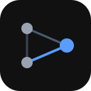

<div align="center">



# HuiNet

### Your agents already share a machine. Give them a network.

Discover local agents · open an A2A bus · share memory — all on `127.0.0.1`.

[](LICENSE)
[](package.json)
[](#scope)
[](docs/agent-integration.md)

**English** · [简体中文](README.zh-CN.md)

[Quick start](#quick-start) · [Is this for you?](#is-huinet-for-you) · [What you get](#what-you-get) · [Docs](docs/agent-integration.md) · [API](docs/api-reference.md)

</div>

---

Claude Code, Cursor, Codex, Gemini CLI, OpenClaw… they sit on **one laptop** and still don’t share a bus, a mailbox, or a working set.

**HuiNet is the local Agent Fabric** — inventory what’s installed, put conversations on a peer mesh, pin a Fabric Brief, and talk through MCP / WebSocket without leaving your desk.

> Not a model router ([Magpie](https://github.com/yetone/magpie) / CC Switch).  
> Not a team issue board.  
> The fabric underneath: who is here, who is on the bus, what they remember together.

```
 Cursor chat A ──┐
 Claude chat B ──┼──►  HuiNet Hub  ──►  mailbox · tasks · brief · canvas
 Codex chat C  ──┘         │
                      127.0.0.1:19527
```

## Is HuiNet for you?

**Yes, if you…**

- Run **more than one** local agent (or multiple chats) and want them to see each other  
- Need **shared memory** you can import, pin, migrate, and link with `[[wikilinks]]`  
- Want **MCP-friendly delivery** (mailbox) because agents don’t get WebSocket push  
- Care that everything stays on **`127.0.0.1`** — no cloud account, no WAN P2P

**Skip it if you…**

- Only use one vendor app on its own plan and never cross tools  
- Need a **provider / model gateway** → use [Magpie](https://github.com/yetone/magpie)  
- Need cloud sync, multi-user SaaS, or public internet mesh (out of scope)

## Quick start

```bash
git clone https://github.com/free-revalution/HuiNet-Network-Core.git
cd HuiNet-Network-Core

npm install
npm run build && npm run build:ui
npm link                     # optional: global `huinet`

huinet app                   # desktop + Hub
# or: huinet start && open http://127.0.0.1:19527
```

Then in the UI: **Scan** → open chats onto the fabric → import sessions → optional **Consult** / **Export Canvas**.

```bash
huinet app --quit
huinet stop
```

### 30-second CLI

```bash
huinet agents scan
huinet agents connect-all
huinet context import --from cursor
huinet bus send --to '*' --message 'hello fabric'
huinet doctor
```

| Command | Does |
|---------|------|
| `huinet start \| stop \| status` | Hub lifecycle |
| `huinet app` | Desktop fabric UI |
| `huinet agents scan \| connect-all` | Inventory + A2A |
| `huinet context import --from …` | Sessions → memory |
| `huinet brief show \| pin <id>` | Working set |
| `huinet mcp install-config --write` | Wire MCP snippet |
| `huinet doctor` | Health |

## What you get

| | |
|---|---|
| **Conversation nodes** | Each Cursor / Claude / Codex chat is a fabric peer — not one blob per app |
| **A2A bus + mailbox** | Live WS for connected peers; durable inbox for MCP (`inbox_check`) |
| **Fabric tasks** | Assign → complete / fail without leaving localhost |
| **Fabric Brief** | Pin facts/decisions; agents pull via MCP `fabric_brief` |
| **Memory links** | `[[Title]]` wikilinks + 1-hop related / project scope |
| **Consult** | Fan-out one prompt to many peers (`consult_agents`) |
| **JSON Canvas** | Export topology for Obsidian / any [JSON Canvas](https://jsoncanvas.org/) tool |
| **Desktop UI** | Dark fabric console · i18n · collapsible inspector |

## How it fits

```
┌──────────────┐  MCP / WS   ┌─────────────────────┐
│  Agents      │◄───────────►│  Local Hub          │
│  (sessions)  │             │  inventory · bus ·  │
└──────────────┘             │  context · mailbox  │
                             └──────────┬──────────┘
                                        │
                             ┌──────────▼──────────┐
                             │  Desktop fabric UI  │
                             └─────────────────────┘
```

1. **Passive discovery** — appear in inventory with no code changes  
2. **MCP** — `list_agents`, `send_message`, `consult_agents`, `fabric_brief`, `context_*`, `fabric_canvas`…  
3. **WS JSON-RPC** — `a2a.register` / `a2a.send` / `a2a.listAgents`  
4. **Importers** — Claude JSONL, Codex rollouts, Cursor transcripts (read-only)

Details: [Agent Integration](docs/agent-integration.md) · [API Reference](docs/api-reference.md)

## MCP snippet

```json
{
  "mcpServers": {
    "huinet": {
      "command": "huinet",
      "args": ["mcp"]
    }
  }
}
```

Or: `huinet mcp install-config --write` (Claude / Cursor / Codex adapters).

## Data on disk

```
~/.huinet/
  config.json
  inventory.json
  network-access.json    # A2A open set
  brief.json
  context/memories/…
```

## Scope

| In | Out (for now) |
|----|----------------|
| Same-machine fabric, MCP, desktop UI | Cross-LAN / public P2P without a relay |
| Session import / migrate / brief | Replacing Magpie-style model gateways |
| Local consult + canvas export | Cloud accounts & sync |

Legacy P2P notes: [`docs/archive/`](docs/archive/).

## Contributing

Issues and PRs welcome. Prefer small, reviewable changes:

1. `npm test` and `npm run build && npm run build:ui`  
2. Keep Hub local-only (`127.0.0.1`) unless the change is explicitly about networking  
3. Match existing TypeScript / desktop patterns; update `README.md` **and** `README.zh-CN.md` when user-facing

## Related

| Need | Project |
|------|---------|
| Model / plan pooling | [Magpie](https://github.com/yetone/magpie) |
| Provider switch UI | [CC Switch](https://github.com/farion1231/cc-switch) |
| Local agent fabric + shared memory | **HuiNet** (this repo) |

## License

[MIT](LICENSE)
